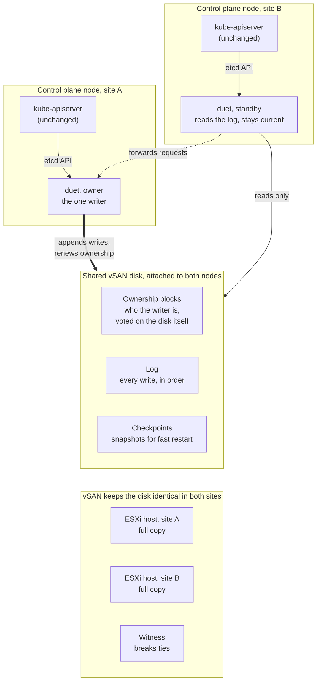

# duet

A Kubernetes control plane datastore for two nodes. It speaks the etcd API,
so kube-apiserver runs unchanged, but instead of a three-member consensus
cluster it keeps its state on one shared, replicated disk with a single
writer at a time.

The target is VMware Cloud Foundation: two control plane VMs sharing one
vSAN-backed disk. vSAN, with the witness it already has, replicates the
disk and breaks ties. duet adds no arbiter of its own.

**This is a demonstration, not a product.** It runs a real kube-apiserver
through node and zone failures on a cloud stand-in for vSAN. It has never
run on vSAN. See [what is proven and what is not](#what-is-proven-and-what-is-not).

## Why

etcd decides by majority, and a majority needs three members. Three
members cannot be spread evenly over two sites: lose the site with two and
the cluster stops. Google and Amazon have both replaced etcd's storage in
their own Kubernetes services with storage they own
([prior art](docs/PRIOR-ART.md)). duet does the same with the storage VCF
owns.

## Architecture



- **Ownership is decided on the disk.** Nodes vote by writing blocks on the
  shared disk (Disk Paxos). A network split between them cannot produce two
  writers.
- **A replaced writer is harmless.** After each write the owner reads the
  disk again and acknowledges only if nobody has started to take over. That
  check uses no clock.
- **The standby is warm.** It reads the log as it grows, so takeover
  replays nothing.
- **State is etcd's own.** The data model is etcd's storage code driven by
  duet's log, so revisions, transactions, watches and compaction behave as
  kube-apiserver expects.

[docs/DESIGN.md](docs/DESIGN.md) has the protocol, its assumptions and the
safety argument.

## Results

Three runs on Google Cloud, two zones, against three-member etcd v3.7.4
under the same load and faults. etcd's three members cannot be split
evenly, so one zone holds two. Every run is in
[docs/LAB-RUNS.md](docs/LAB-RUNS.md).

| | duet, two nodes | etcd, three members |
| --- | --- | --- |
| Worst zone lost for 40 s: time without writes | 5.9 s, 2.5 s, 2.7 s | 45.6 s, 46.2 s, 46.6 s |
| Leader killed: time without writes | 6.6 s, 2.6 s, 2.2 s | 3.0 s, 1.1 s, 3.0 s |
| 8 clients, writes per second | 1,781, 1,791, 658 | 1,616, 1,482, 1,467 |
| 128 clients, writes per second | 6,791, 6,771, 7,000 | 8,755, 8,320, 7,469 |
| Acknowledged writes lost | 0 | 0 |

The first duet figure in each cell is with a 5 s ownership lease, the
others with 2 s. A real kube-apiserver v1.37.2, with controller manager,
scheduler and simulated nodes, has also run on both
([test/kube](test/kube/README.md)).

## What is proven and what is not

Shown so far:

- No acknowledged write lost under process kills, freezes, VM suspend, VM
  reset and zone loss, in simulation, as local processes and on Google
  Cloud.
- Kubernetes' own storage test suite passes (44 entries), and a real
  control plane converges through a leader kill.
- Zone loss costs one lease period, where three-member etcd waits for the
  zone to return.

Not shown:

- **Anything on vSAN.** The design assumes that a read on one host sees a
  write completed on another, and that a completed flush is on both hosts.
  Neither is verified ([docs/VCF-GAPS.md](docs/VCF-GAPS.md)).
- **Speed under heavy load.** etcd was about a quarter faster at 128
  clients in two runs of three.
- **Independence from the disk's speed.** duet's latency is the shared
  disk's latency as seen from the writer. In one run that was twice as slow
  from one node.
- **Long runs.** Log space is reclaimed and reused, tested over seven laps
  of a small log, but nothing has run for more than a few minutes.
- **Scale.** Tested to 6,000 simulated pods on one machine.

[docs/STATUS.md](docs/STATUS.md) lists every component and how it was
tested.

## Try it

Go 1.26 or later. Everything below runs on one machine.

```
go test -short ./...     # simulation, a few seconds
go test ./...            # adds real processes on a disk image, under a minute
```

Two nodes by hand:

```
go build -o duet ./cmd/duet
truncate -s 2G disk.img
./duet format -device disk.img -nodes 2 -ttl 2s -checkpoint-size 268435456
./duet run -device disk.img -node 0 -listen 127.0.0.1:7100 -etcd 127.0.0.1:23790 -etcd-peers 127.0.0.1:23790,127.0.0.1:23791 &
./duet run -device disk.img -node 1 -listen 127.0.0.1:7101 -etcd 127.0.0.1:23791 -etcd-peers 127.0.0.1:23790,127.0.0.1:23791 &
etcdctl --endpoints=127.0.0.1:23790,127.0.0.1:23791 put hello world
```

With Kubernetes binaries to hand, [test/kube](test/kube/README.md) runs a
real kube-apiserver against duet or against etcd and kills the leader.

## Repository

| Path | What is there |
| --- | --- |
| `pkg/disk` | Disk layout and checksummed metadata blocks |
| `pkg/wal` | The record log, with group commit |
| `pkg/lease` | Ownership: Disk Paxos over per-node blocks, plus a lease that says when to challenge |
| `pkg/node` | Writer, reader and takeover; the fault simulation and its tests |
| `pkg/trim` | What makes log space safe to reuse |
| `pkg/ckpt` | Checkpoints on the shared disk |
| `pkg/sm` | The state machine: etcd's storage, transaction and lease code driven by the log |
| `pkg/api` | The etcd v3 gRPC services kube-apiserver uses |
| `cmd/duet` | The binary: `format`, `run`, and test tools |
| `test/proc` | Fault tests on real processes |
| `test/kube` | Kubernetes storage conformance, kube-apiserver and control plane scripts, the etcd comparison |
| `deploy/lab-gcp` | The Google Cloud lab: Terraform, scenario script, GitHub workflow |

## Documents

Read in this order.

1. [docs/PRIOR-ART.md](docs/PRIOR-ART.md): what Kine, GKE, EKS and others did, and what duet takes from each
2. [docs/DESIGN.md](docs/DESIGN.md): the protocol, assumptions, decisions and what remains
3. [docs/LAB-RUNS.md](docs/LAB-RUNS.md): every lab run, including the ones that found bugs, and the comparison with etcd
4. [test/kube/README.md](test/kube/README.md): Kubernetes test results
5. [docs/VCF-GAPS.md](docs/VCF-GAPS.md): what must be verified or changed in VCF
6. [docs/STATUS.md](docs/STATUS.md): component by component, what exists and how it was tested
7. [docs/LAB.md](docs/LAB.md): how to run the Google Cloud lab yourself

## References

- [Kine](https://github.com/k3s-io/kine): the etcd shim used by k3s
- [GKE at 65,000 nodes](https://cloud.google.com/blog/products/containers-kubernetes/gke-65k-nodes-and-counting): the etcd API on Spanner
- [Amazon EKS ultra scale clusters](https://aws.amazon.com/blogs/containers/under-the-hood-amazon-eks-ultra-scale-clusters/): consensus moved out of etcd into a journal
- [Amazon MemoryDB](https://www.amazon.science/publications/amazon-memorydb-a-fast-and-durable-memory-first-cloud-database): the journal design
- [Two-node OpenShift with fencing](https://www.redhat.com/en/blog/two-node-openshift-fencing-improves-reliability-edge)
- [Disk Paxos](https://www.microsoft.com/en-us/research/publication/disk-paxos/), Gafni and Lamport
- [Vertical Paxos and primary-backup replication](https://www.microsoft.com/en-us/research/publication/vertical-paxos-and-primary-backup-replication/), Lamport, Malkhi and Zhou
- [Clustering applications on vSAN](https://techdocs.broadcom.com/us/en/vmware-cis/vsan/vsan/8-0/vsan-administration/expanding-and-managing-a-vsan-cluster/clustering-applications-on-vsan.html), Broadcom

## License

Apache-2.0. See [LICENSE](LICENSE).
